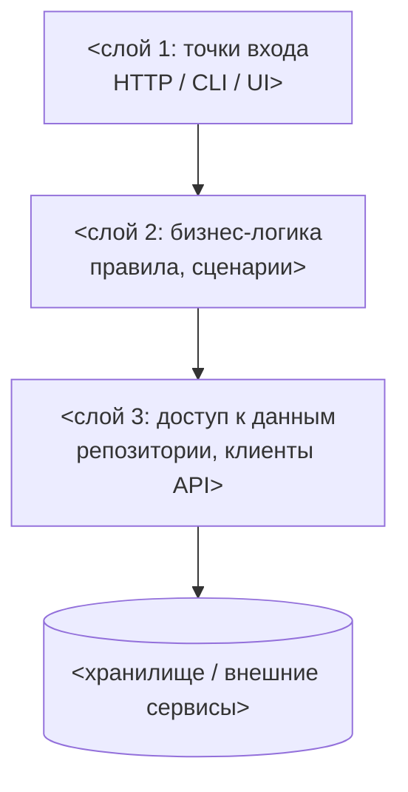

# Карта проекта

**Что это.** Навигационный индекс: где что лежит, как части связаны, куда идти за конкретным изменением.
Отвечает на вопрос «где?». Не отвечает на «почему так спроектировано» (архитектурный док) и «как установить» (README).

**Как пользоваться.** Нужно что-то поменять — сначала найдите это в разделе 3 или 10, потом открывайте код.
Не нашли — значит карта неполная; дополните её тем, что выяснили.

> **Статус: скелет.** Репозиторий пуст, кода нет. Всё в угловых скобках `<...>` заполняется по мере появления кода.
> Разделы 4–7 и 10 пока без содержимого — это нормально, они наполняются первыми же коммитами.

---

## 1. Проект в двух строках

| | |
|---|---|
| **Что это** | `<одна фраза: какую задачу решает продукт>` |
| **Для кого** | `<пользователи / заказчик>` |
| **Стек** | `<язык, фреймворк, БД, ключевые библиотеки>` |
| **Статус** | стартовая точка, код ещё не добавлен |

---

## 2. Быстрый старт

| Команда | Что делает |
|---|---|
| `<npm install / pip install -r ...>` | установка зависимостей |
| `<npm run dev / python -m ...>` | запуск для разработки |
| `<npm test / pytest>` | тесты |
| `<npm run lint>` | линтер и форматтер |
| `<npm run build>` | сборка |

Правило: если команды нет в этой таблице, её нет в проекте. Всё, что нужно запускать руками, живёт здесь.

---

## 3. Структура каталогов

<!-- TREE:BEGIN -->
```
.
└── PROJECT_MAP.md      ← вы здесь
```
<!-- TREE:END -->

Блок между маркерами `TREE:BEGIN/END` генерируется автоматически по фактическому дереву файлов —
не правьте его руками, правьте каталоги.

| Каталог | За что отвечает | Что сюда кладут |
|---|---|---|
| `<src/>` | `<основной код>` | `<...>` |
| `<tests/>` | `<тесты>` | `<...>` |
| `<docs/>` | `<документация>` | `<...>` |
| `<scripts/>` | `<утилиты и разовые скрипты>` | `<...>` |

**Правило размещения:** новый код идёт в тот каталог, чья зона ответственности совпадает с задачей.
Если подходящего нет — сначала создайте каталог и опишите его здесь, потом код.

---

## 4. Точки входа

С чего начинается исполнение. Отсюда удобно начинать чтение незнакомого кода.

| Точка входа | Файл | Что запускает |
|---|---|---|
| `<сервер>` | `<path>` | `<...>` |
| `<CLI>` | `<path>` | `<...>` |
| `<фоновый воркер>` | `<path>` | `<...>` |

---

## 5. Карта модулей и слои



**Правила зависимостей** — важнее самой схемы, потому что именно они держат проект от превращения в кашу:

| Слой | Может зависеть от | Не имеет права знать о |
|---|---|---|
| `<слой 1>` | `<слой 2>` | `<слой 3 напрямую>` |
| `<слой 2>` | `<слой 3>` | `<фреймворки ввода-вывода, HTTP-детали>` |
| `<слой 3>` | `<базы, внешние API>` | `<бизнес-логика>` |

Зависимости направлены только вниз. Стрелка наверх — признак, что код лежит не в том слое.

---

## 6. Ключевые сценарии

Сквозные трассировки: одна строка — один шаг по файлам. Самый ценный раздел карты.

### Сценарий: `<название, напр. "пользователь регистрируется">`
```
<HTTP POST /signup>  →  <routes/signup.ts>  →  <services/auth.ts>  →  <repos/user.ts>  →  <БД>
                                                    ↓
                                          <отправка письма: queue/email.ts>
```

Держите здесь 2–4 самых важных сценария. Для остальных достаточно строки в разделе 3.

---

## 7. Внешние зависимости и интеграции

| Сервис | Зачем | Где конфиг | Что будет, если упадёт |
|---|---|---|---|
| `<БД>` | `<...>` | `<env / файл>` | `<деградация / полный отказ>` |
| `<внешний API>` | `<...>` | `<env>` | `<...>` |

---

## 8. Конфигурация и секреты

| Файл | Назначение | В git? |
|---|---|---|
| `<.env.example>` | список переменных без значений | **да** |
| `<.env>` | реальные значения | **нет, в .gitignore** |

Секреты, токены и пароли в репозиторий не попадают никогда — ни в код, ни в тесты, ни в историю коммитов.

---

## 9. Соглашения

| Область | Правило |
|---|---|
| Ветки | `<напр. arena/<id>-repo для сессий; feature/* для фич>` |
| Коммиты | `<напр. короткая императивная строка, что сделано и зачем>` |
| Стиль кода | `<линтер + форматтер, конфиг в ...>` |
| Тесты | `<что обязательно покрывается, где лежат>` |
| Именование | `<файлы: kebab/snake/camel; модули: ...>` |

---

## 10. Рецепты: «хочу сделать X»

Шаблон ответа: **создать** → **зарегистрировать** → **протестировать**. Забытая «регистрация» — самая частая причина «код есть, а ничего не работает».

| Задача | Шаги |
|---|---|
| `<Добавить эндпоинт>` | `<создать handler в ...>` → `<зарегистрировать в роутере ...>` → `<тест в ...>` |
| `<Добавить модель / миграцию>` | `<...>` |
| `<Добавить UI-компонент>` | `<...>` |
| `<Добавить фоновую задачу>` | `<...>` |

---

## 11. Грабли и техдолг

Места, которые выглядят странно, но так и задуманы, и то, что временно и требует переделки.

| Место | В чём подвох |
|---|---|
| `<...>` | `<почему так и что нельзя ломать>` |

---

## 12. Глоссарий

Доменные термины, которые в коде называются иначе, чем в жизни.

| Термин | Значение в проекте |
|---|---|
| `<...>` | `<...>` |

---

## Как поддерживать эту карту

1. **В том же коммите.** Изменили структуру, точку входа, сценарий — тут же поправьте карту. Карта, отставшая от кода, хуже отсутствия карты: она врёт.
2. **При ревью.** Расхождение кода с картой — причина отклонить PR, а не «допишем потом».
3. **Дерево не руками.** Раздел 3 обновляется генератором, руками — только таблица «каталог → ответственность».
4. **Стремитесь к краткости.** Карта читается за 5 минут. Если раздел разросся — вынесите в `docs/` и оставьте здесь ссылку.
